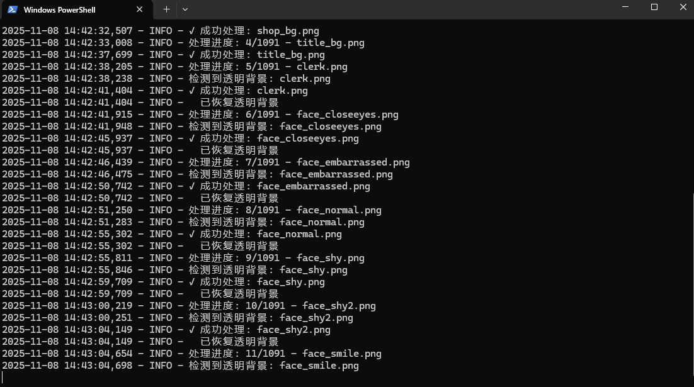
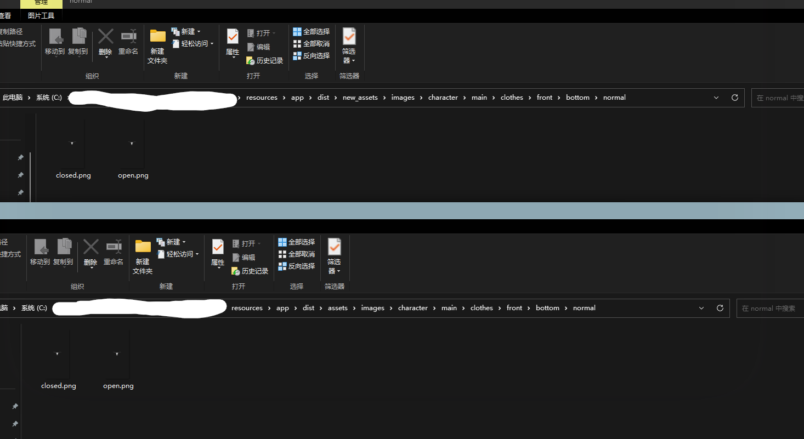

# DeepCreamPy Batch Processor

通过 [deepcreampy-fastapi](https://github.com/fajlkdsjfajdf/deepcreampy-fastapi) 批量处理二次元图片，保留文件名、目录结构，并可恢复透明背景。适合需要按原有资源目录整理输出的游戏素材处理任务。

> [!NOTE]
> 本项目已停止更新。需要图形界面、免部署 API 的版本，请使用 [Aletheia-Lens](https://github.com/Cec1c/Aletheia-Lens)；其 Release 可直接运行，无需安装 Python。两者提供同类图像处理功能。

## 处理效果

处理一组图片时，程序在新的输出目录中保留原有文件层级。对于透明素材，使用 `-t` 恢复透明背景。图像修复效果取决于所用模型及遮挡范围，可先用少量代表性图片选择处理模式。

### 批量处理进度



### 输出目录与透明背景



## 准备服务

先按 [deepcreampy-fastapi](https://github.com/fajlkdsjfajdf/deepcreampy-fastapi) 的说明安装并运行 API 服务。浏览器能打开 `http://localhost:8001/docs` 后，在本项目目录安装 Python 依赖：

```bash
pip install -r requirements.txt
```

API 服务负责图像识别和修复，本脚本负责批量提交、目录组织与透明背景处理。

## 处理一个目录

在项目目录运行以下命令，将 `-f` 后的示例路径替换为图片目录：

```bash
python main.py -f "C:\download\benzi"
```

程序创建 `new_benzi` 输出目录，并保留内部文件层级。`-f` 为必填参数；本机 API 使用默认端口时可省略 `-u`。

运行以下命令可查看完整参数说明：

```bash
python main.py
```

## 选择处理模式

处理纯色色块：

```bash
python main.py -f "C:\download\benzi" -m 0
```

修复马赛克区域：

```bash
python main.py -f "C:\download\benzi" -m 1
```

默认模式 `2` 在修复后放大图片。遮挡较厚的区域可能生成不自然的细节，可改用模式 `1` 比较效果。其余两个模式用于对接 API，参数以程序帮助为准。

## 恢复透明背景

透明背景恢复默认关闭。处理带透明图层的游戏素材时，加上 `-t`：

```bash
python main.py -f "C:\download\benzi" -m 2 -t
```

## 继续中断的任务

重新运行相同命令时，程序跳过输出目录中已有的同名文件，继续处理剩余图片。需要重新生成已有文件时，可选择覆盖模式。

## 来源与反馈

本工具使用或基于以下项目：

- [DeepCreamPy](https://github.com/cookieY/DeepCreamPy)
- [hent-AI](https://github.com/natethegreate/hent-AI)
- [deepcreampy-onnx-docker](https://github.com/nanoskript/deepcreampy-onnx-docker)
- [deepcreampy-fastapi](https://github.com/fajlkdsjfajdf/deepcreampy-fastapi)

问题与使用反馈可提交到本仓库 Issues。
